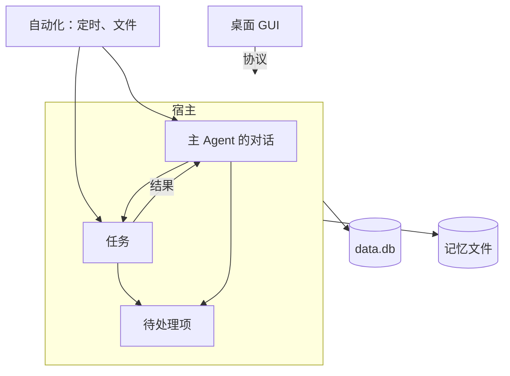

# Atlas 设计

> 草稿，尚不完善，未实现。

Atlas 是一个在用户自己的电脑上长期运行的个人 Agent。用户面对的是它的主 Agent：主 Agent 记得用户，能通过自动化主动做事，把需要动手完成的工作交给任务并行推进，并且只在需要时打扰用户。

核心思路：**主 Agent 是用户面对的唯一身份，可以同时有多个对话，它们共用一套记忆与待处理项；需要动手完成的工作由对话交给任务，任务归建立它的对话管理。任务要读写文件、执行命令，所以每个任务都在一个固定的工作目录里进行。**

## 目标与非目标

目标：

- **连续**：用户面对的是一个长期存在的主 Agent。它的各个对话共享记忆与待处理项，能查询彼此的历史与任务，而不是一组互不相知的对话。
- **记忆**：关于用户的偏好、事实与过往工作，在主 Agent 的所有对话与所有任务之间共享，在对话被压缩之后仍然可用，并且可见、可改、可撤销。
- **主动**：定时与文件变化等自动化触发后，先过滤再决定是否行动；无事时保持安静。
- **并发**：主 Agent 的多个对话与多个任务同时推进，用户随时可以说下一句话。

Atlas 服务用户的生活与工作，编码是它的核心能力之一，不是全部。

非目标：

- 托管云服务与多用户；Atlas 只在用户的电脑上运行，数据在 `~/.atlas/`。
- 当前阶段只有桌面入口；编辑器、手机、即时通讯与 webhook 等入口和外部来源见“后续”。
- 多个平级的 Agent 或 Bot。
- 通用的电脑操控与浏览器自动化。

## 原则

- **只有一个主 Agent**：用户只面对一个主 Agent，不为多个身份预留结构。
- **没有权限审核**：工作只来自用户本人与用户自己建立的自动化，所以执行不经过审批。这是有前提的：引入其他入口、外部来源或能对外发消息的连接之前，必须先补上信任与授权的设计。
- **有界的自主**：任务、自动化与全局用量都有预算，到达上限就停下来问用户，不静默失败，也不静默继续。
- **无事安静**：只有结果、问题与失败值得打扰用户；主动检查一无所获时不说话。
- **可见、可撤销**：建立任务的理由、记忆的变化，用户都能看到；记忆的变化都能撤销。
- **外部内容是数据**：网页、邮件、文件中的文字不是指令，进入模型时如实标注来处。
- **记录不可变**：消息与触发记录创建后不再修改，不依赖深拷贝来保证。
- **一致性顺序**：先写库，再改内存，最后推送给客户端。
- **单一权威**：运行时数据只有宿主一个权威，数据库只由宿主打开。

## 用语

| 用语 | 含义 |
| --- | --- |
| 主 Agent（main） | 用户面对的那个 Agent：身份说明、对话、记忆、待处理项、自动化与预算的归属者。它名下可以有多个对话，没有工作目录 |
| 对话（conversation） | 主 Agent 名下的一段对话，有自己的上下文与自己建立的任务，没有工作目录。多个对话可以同时运行，共用主 Agent 的记忆与待处理项 |
| 任务（task） | 对话交出去、需要动手完成的一件工作：读写文件、执行命令。建立时固定一个工作目录，有自己的模型设置、对话、状态与结果，做完即结束 |
| 所属对话 | 建立某个任务的那个对话：只有它能管理这个任务，并接收它的结果。其他对话只能查询 |
| 任务的对话 | 完成一个任务的对话，在任务的工作目录里读写文件、执行命令 |
| 会话（session） | 主 Agent 的对话与任务的对话在实现上的统称：只追加的历史，加上由它折叠出的上下文 |
| 一轮（turn） | 会话中从一条输入开始、到模型不再调用工具为止的过程；进行中收到的新消息并入这一轮 |
| 宿主（host） | Atlas 的运行时：持有全部运行时数据与数据库。目前运行在桌面 App 进程内 |
| 客户端（client） | 通过协议使用宿主的程序；目前只有桌面 GUI |
| 自动化（automation） | 用户设定的自动触发：定时、文件变化 |
| 触发记录 | 自动化的一次触发，不可变，先写库再处理 |
| 待处理项（attention item） | 需要用户知晓或决定的一条事项：结果、提问、失败、预算到限。主动送达用户的唯一途径 |
| 记忆（memory） | 主 Agent 长期记得的内容，以文件保存，分常驻层与笔记 |
| 常驻层 | 记忆中总在系统提示词里的部分：关于用户的少量核心事实 |
| 笔记（note） | 记忆中按主题保存的部分，用工具检索与读取 |
| 预算（budget） | 对请求次数、时长与费用的上限，按任务、自动化与全局三级设置 |
| 技能（skill） | 一份可复用的做法说明，按需载入上下文 |
| 指令（instructions） | 用户手写的长期要求：全局的 `~/.atlas/AGENTS.md` 与各工作目录的 `AGENTS.md` |
| 系统提示词（system prompt） | 每次请求模型时放在最前面的内容：身份说明、指令、记忆常驻层与笔记索引 |
| 压缩（compaction） | 把上下文中较早的部分替换为摘要，历史保持不变 |
| 通知（notice） | 会话历史中只给人看的记录，如压缩失败；不进入上下文 |
| 更新（update） | 宿主推送给客户端的变化 |

方法名与类型名中的 `Prompt` 专指用户消息，系统提示词一律写 `SystemPrompt`；工作目录在代码里一律叫 `cwd`。

## 用户看到什么

```
主 Agent
 ├─ 对话：东京行程、周报、……（没有工作目录，没有面板）
 ├─ 任务
 │   ├─ 任务 A ── ~/code/atlas     ── 任务的对话 + 终端、更改、文件
 │   ├─ 任务 B ── ~/code/blog      ── 任务的对话 + 终端、更改、文件
 │   └─ 任务 C ── ~/Documents/税务 ── 任务的对话 + 终端、更改、文件
 └─ 待处理
```

- **对话视图**：主 Agent 的一个对话，没有终端、更改、文件这类面板。打开 App 时回到最近的对话；换话题时用户可以新建对话，不新建也可以一直在同一个对话里说。
- **待处理**：需要用户的事项，是主动打扰用户的唯一出口。
- **任务视图**：任务的对话，加上终端、更改、文件面板，面板打开的是任务的工作目录。用户可以在这里直接对任务说话。
- **建立任务**：通常由主 Agent 在某个对话中建立，任务归这个对话管理；用户也可以自己建立，选定工作目录并说明要做的事，这样的任务不属于任何对话。
- **管理任务**：用户在任务视图里可以直接对任何任务说话、更换模型或取消，这是本人的操作，不经过任何对话。

每次建立任务都在所属对话里显示一张任务卡片：做什么、在哪个目录、用哪个模型、为什么；用户可以打开、更换模型或取消。

### 多个窗口

- 窗口只是视图。主窗口有侧栏，显示对话、任务或待处理、自动化、记忆这些页面；对话或任务可以“在新窗口打开”，新窗口只显示它本身。多个窗口可以各开一个对话，也可以显示同一样东西。
- 终端、更改、文件面板依赖主窗口的当前任务，只在主窗口里。
- 输入框发给当前显示的对象：对话视图里是给这个对话的消息，任务视图里是给这个任务的消息。
- 多个窗口同时向同一个对话发消息时，消息按写入顺序进入；这个对话正在运行时，新消息排队，并入这一轮。不同的对话互不影响。
- 显示的对象、草稿与滚动位置是窗口自己的界面状态；对话、任务与待处理项是宿主的数据，所有窗口共享，靠更新保持一致。
- 关闭主窗口只隐藏它，宿主继续运行；关闭另外的窗口不影响任何运行。

## 总体结构



一件事的流转有两条路径：能在对话中完成的事，由主 Agent 在当前对话里直接处理并答复；需要动手完成的工作，由对话或用户建立任务，任务完成后结果汇报回所属对话，并成为待处理项。自动化触发后按它的设定进入其中一条。

## 权威与数据

| 数据 | 是什么 | 唯一权威 |
| --- | --- | --- |
| 对话与任务 | 对话的标题与状态；任务的工作目录、模型设置、所属对话、预算、状态与结果 | 数据库，宿主内存中的对象是它们的投影 |
| 历史 | 一个会话中发生过的全部记录，只追加 | 数据库 |
| 上下文 | 下一次请求发给模型的消息 | 由历史折叠得到，规则只定义一次 |
| 待处理项 | 等待用户的事项及其处理结果 | 数据库 |
| 自动化与触发记录 | 自动化的设定；每次触发的记录，只追加 | 数据库 |
| 记忆 | 主 Agent 长期记得的内容 | 记忆文件；版本、作者与遗忘记录在数据库 |
| 设置与凭据 | 模型接入、预算默认值、凭据 | `settings.json`、`auth.json` |

所有写入都由宿主完成：先在一个事务里写库，再改内存，最后推送更新。客户端显示的一切都是这些数据的视图，只随更新变化，不自行推算。

## 主 Agent 的对话

- 主 Agent 名下可以有多个对话，每个对话有自己的上下文，没有工作目录，可以同时运行。
- 对话直接处理能在对话中完成的事：回答问题、讨论与规划、检索记忆与历史、读写记忆。
- 需要动手完成的工作（读写文件、执行命令）交给任务，对话自己不读写工作文件，也不执行命令。对话管理自己建立的任务：追加消息、更换模型、取消，并接收它们的结果。
- 对话只能查询其他对话的任务的状态与结果，不能操作。用户在一个对话里要求改动别的对话的任务时，对话告诉用户这个任务属于哪个对话，并给出入口。
- 建立任务时要为它确定工作目录与模型。工作目录不能确定时先问用户，不猜；模型默认沿用设置中的任务默认模型。
- 一个对话同时只有一轮；用户的新消息并入正在进行的一轮，所以用户随时可以说下一句。并行发生在不同的对话之间，以及不同的任务之间。
- 对话之间不共享上下文，靠共用的记忆、待处理项与历史检索彼此关联。本对话正在进行的任务清单随每条输入附在消息里，不放进系统提示词，以保持提示词缓存；其他对话的任务不附上。
- 对话的上下文保留对话本身与自己任务的状态和结果，任务的细节留在任务的对话里。
- 长期使用的对话靠压缩维持；压缩不改变历史。

## 任务

任务记录：所属对话、标题、工作目录、模型与思考深度、预算与用量、状态、结果。

| 状态 | 含义 |
| --- | --- |
| `queued` | 已建立，等待执行 |
| `running` | 任务的对话正在运行 |
| `waiting` | 用完了预算，等用户追加或放弃 |
| `interrupted` | 宿主停止时正在运行，等待恢复判断 |
| `done`、`failed`、`cancelled` | 结束，带结果或原因 |

- 任务要读写文件、执行命令，所以建立时必须固定工作目录，此后不变。任务的对话按工作目录载入指令与技能。
- 任务归所属对话管理，结果汇报回所属对话。用户自己建立的任务没有所属对话，自动化的任务归自动化的对话，这两种的结果只进入待处理。用户在任务视图里可以直接操作任何任务。
- 主 Agent 与用户建立的任务，在 git 工作树里时默认在独立的 worktree 中进行，worktree 的路径就是任务的工作目录，结果作为分支交给用户，避免多个任务改同一份文件；自动化直接建立的任务就在设定的目录里进行。删除任务时，worktree 没有未提交的修改才一并移除，分支保留。
- 同时运行的任务有全局上限，超出的排队。
- 一轮进行中收到的消息在下一次请求模型之前并入上下文，不需要等这一轮结束。
- 任务的一轮结束就是任务结束，最后一条回复就是结果，完整保存与汇报，不截断；结果汇报回所属对话，同时成为待处理项。任务需要用户回答时，也是以提问结束，用户在任务视图里回答，或由所属对话追加消息，就重新打开它，仍在原来的工作目录。
- 所属对话与用户在任务视图中的操作可能同时到达，由宿主按到达顺序处理。

### 重启与恢复

- 宿主重启时，`running` 的任务转为 `interrupted`。
- 历史里先记下工具调用，执行完再记下结果，所以恢复时只看任务历史的末尾：所有调用都有结果，或者没有结果的调用都是只读的，就自动恢复；有不是只读的调用没有结果，就无法知道它是否已生效，生成待处理项，由用户决定继续还是放弃。
- 每个工具声明自己是否只读；无法判断的工具（如任意命令）一律不算只读。
- 打开任何会话时，历史末尾没有结果的调用都补上一条“不知道是否已生效”的结果，上下文因此总能接着请求模型；主 Agent 的对话不自动恢复，用户接着说就行。

## 会话与一轮

- 会话的历史只追加，记录用户输入、模型回复、工具调用与结果、压缩、通知等。
- 上下文由历史折叠得到：压缩记录把较早的部分替换为摘要，通知等只给人看的记录不进入上下文。折叠规则只定义一次，实时推进与重新加载都用它，因此内存中的上下文始终等于历史折叠的结果。
- 一个会话同时只有一轮。一轮由执行循环驱动：请求模型、执行工具、再请求，直到模型不再调用工具、被取消、或达到预算。
- 执行循环是纯逻辑：给定一份输入快照，产出事件与新的记录，不做存储，也不持有会话。
- 模型请求失败时按策略重试；失败的尝试作废，不进入历史。

## 自动化

- 自动化的设定：触发方式（定时或文件变化）、程序过滤条件（文件名的通配符）、要做的事、每天的预算、提醒级别，以及处理方式。
- 宿主每半分钟检查一次：定时规则有没有到点，监视的目录与上一次的快照相比有没有文件变化；不依赖系统的文件监视，所以变化最多晚半分钟被发现。
- 每次触发先写入触发记录，以“自动化加触发点”去重，同一个触发点只处理一次；宿主重启后从未处理完的触发记录继续。错过的触发点不补做。
- 触发后先用程序条件过滤，不满足就结束。
- 处理方式有两种：设定了工作目录的，直接建立任务；没有的，交给这个自动化自己的对话判断，由它决定直接处理、建立任务还是什么都不做。两种情况下任务都归这个自动化的对话管理。
- 自动化的对话只通过待处理项告知用户；它在对话列表之外，从自动化的设定里打开。

## 记忆

```
~/.atlas/memory/
├── MEMORY.md          常驻层：关于用户的核心事实，每行一条
└── notes/             笔记：按主题分目录，每篇一个主题，开头说明何时读
```

- 常驻层只放关于用户本人的少量核心事实，如称呼、偏好与长期约定，由宿主放进系统提示词；其余都写成笔记。项目的工作约定写在该项目的 `AGENTS.md`，不进记忆。
- 笔记由主 Agent 的对话与任务的对话用工具检索与读取，范围是全部记忆；系统提示词里只放笔记的索引。主题目录（如“公司”“家庭”）只是组织方式，不是隔离。
- 宿主不在每轮自动召回记忆；出现该查而没查的真实例子之后，再考虑加上。

**载入**

- 常驻层与笔记索引有容量上限，按 token 计，一个汉字算一个。常驻层超过上限时在系统提示词里明确标出，不静默截断，由模型把细节移入笔记；笔记索引超出上限时只列前面的几篇，并说明还有多少。
- 系统提示词在会话打开时确定，以稳定提示词缓存。记忆变化后，主 Agent 的对话在下一条用户消息前收到最新的记忆；任务在打开时读取最新版本。

**写入**

- 写入原子化，并以内容哈希做比较后写入，不覆盖其他会话或用户的并发修改；用户用编辑器的修改同样被记录。
- 用户亲自发起的工作可以增删记忆；自动化触发的无人值守工作只能追加。
- 每次变化都检查隐藏字符、植入的指令与凭据，不通过的变化被退回并说明原因。
- 每个版本的全文、作者、原因与来源消息都记在数据库里；任何一次变化都可以撤销。
- 用户要求遗忘的内容留下墓碑，自动整理不能再把它写回。

**自动整理**

- 只有一个后台写入者，在对话空闲一段时间后，读这个对话里书签之后用户亲手输入的话，请默认模型提出要记的事实，用量计入全局预算。
- 每条新增的个人事实必须引用用户亲手输入的原话；宿主送入的输入、技能全文不算，模型提出的原话不在用户的输入里就丢掉。
- 单次变化有上限，只追加与标记，不整篇改写。矛盾的旧事实标记为已取代，不直接删除。

**检索**

- 记忆检索与历史检索都覆盖全部内容，包括其他对话与所有任务，结果注明来自哪个对话或任务。
- 先用子串匹配；数据量使它不可接受时再建索引。中文索引需要能匹配一到两个字的词。
- 不使用向量与知识图谱，直到关键词检索加模型改写确实漏掉了真实的问题。

## 待处理项

- 主动送达用户的只有待处理项。任务的结果、提问与失败，以及自动化的发现，都成为待处理项。
- 任务的结果另外汇报回所属对话，用户在那个对话里可以直接接着谈。
- 待处理项分三级：立即通知（需要回答、预算到限、严重失败）、汇总（普通结果）、只记录。
- 同一件事只提醒一次；用户在任何窗口处理之后即消失。
- 用户可以按自动化调整提醒级别。
- 主动检查（例如每天的回顾）一无所获时不产生任何待处理项。

## 预算

- 预算分三级：任务、自动化（每日）、全局（每日），以模型请求次数计；默认值写在 `settings.json` 的 `budget` 里，自动化可以各自设定。一轮另有单轮的上限，拦住失控的循环。
- 主 Agent 的对话计入全局预算；自动化的对话与它建立的任务同时计入该自动化的预算；自动整理记忆等后台工作计入全局预算。
- 任务到达上限时转为 `waiting`，生成待处理项，由用户决定追加预算或停止。
- 全局用量接近上限时暂停自动化触发的工作，把余量留给用户亲自发起的事；到达上限时所有新的模型请求都停下，生成待处理项。

## 能力

- **工具**：任务的对话有文件、命令、检索与记忆工具；主 Agent 的对话有检索与记忆工具，管理自己任务的工具，以及只读查询其他任务的工具；自动化的对话另有提醒用户的工具。每个工具声明自己是否只读。
- **技能**：可复用的做法说明，来自全局与工作目录，按需载入。主 Agent 可以在任务结束后提议新技能，由用户确认后保存。

## 宿主与客户端

- 宿主运行在桌面 App 进程内。关闭窗口只隐藏窗口，宿主继续运行；退出 App 时宿主取消所有运行并停止，下次启动时按“重启与恢复”处理。App 可以随开机启动。
- 桌面 GUI 只通过协议使用宿主，由编译器保证它拿不到宿主的内部状态。保留这道边界，是为了以后加入其他入口时不必返工。
- 协议的方法都是“请求加响应”；变化以更新推送。更新分两类：会话内的（消息、工具调用、运行状态）与全局的（对话清单、任务、待处理项、记忆、自动化的变化）。
- 实时更新与历史回放由同一组转换生成，客户端只有一条渲染路径。
- 所有窗口共用一个协议连接；宿主同步推送更新，客户端接收时必须很快返回。
- 终端、文件、更改面板是任务视图在本机的功能，不经过协议，打开的是任务的工作目录。

## 存储

`~/.atlas/` 下：

| 位置 | 内容 | 读写者 |
| --- | --- | --- |
| `data.db` | 对话、任务、会话历史与二进制、待处理项、自动化与触发记录、记忆的版本与墓碑、预算用量 | 宿主 |
| `memory/` | 记忆文件 | 宿主；用户可以用任何编辑器修改，宿主记为用户的修改 |
| `skills/` | 全局技能 | 宿主、用户 |
| `AGENTS.md` | 全局指令 | 用户 |
| `settings.json`、`auth.json` | 模型接入、默认模型、默认预算、凭据 | 宿主 |
| `gui.json` | 桌面界面的偏好 | 桌面 GUI |

- 历史与触发记录只追加；对话、任务、待处理项等可变状态的每次变化都在一个事务里写入。
- 二进制以内容哈希寻址，消息中只存引用。
- 同时只应运行一个 App；数据库只由它的宿主打开。
- 不兼容旧版本：数据结构从零设计，新版本使用新的数据库文件 `data.db`，不读取、不迁移，也不改动旧版本的 `atlas.db` 与 `schedule.json`。
- 重构完成之前，表结构可以直接修改，不写迁移。

## 分层

```
cmd/atlas ── 组装：打开库，建宿主，交给桌面 GUI
   │
  gui ──► protocol（接口与数据类型，不依赖任何包）
             ▲
             │ 实现
           core ──► agent
             ├────► llm ──► agent
             ├────► tools ─► agent
             ├────► memory
             ├────► schedule
             ├────► systemprompt ─► skills
             ├────► store
             └────► config
```

| 包 | 职责 |
| --- | --- |
| `protocol` | 客户端与宿主之间的接口、请求、响应与更新类型；只有数据，没有逻辑，不依赖其他包 |
| `core` | 宿主的运行时权威：对话、任务、自动化、待处理项、预算、恢复，以及协议的实现 |
| `agent` | 执行循环、消息类型、折叠与压缩；纯逻辑，不做 IO，不依赖其他内部包 |
| `llm` | 模型提供方的适配；`core` 不知道有哪些提供方 |
| `tools` | 文件与命令工具，及其是否只读的声明；记忆、检索、管理任务这些要用宿主数据的工具在 `core` 里 |
| `memory` | 记忆文件的规则：检查、容量、版本、遗忘、整理的审核；纯逻辑，文件读写由调用方完成 |
| `schedule` | 定时自动化的触发判定；纯逻辑，不读时钟 |
| `systemprompt`、`skills` | 组装主 Agent 与任务的系统提示词，发现技能 |
| `store` | SQLite 的存取；不理解记录正文 |
| `config` | 设置与凭据文件的读写 |
| `gui` | 桌面客户端，对话与任务相关的功能只通过 `protocol` 使用宿主 |

纯逻辑的包（`agent`、`memory`、`schedule`）不依赖其他内部包，便于单独验证。

## 三条典型路径

**用户在一个对话里问“下周去东京，帮我想想行程”**

1. GUI 把用户消息发给这个对话，宿主写入历史，推送更新。
2. 这件事在对话中就能完成，主 Agent 读取记忆中的偏好、查阅资料，直接答复。
3. 同一时间用户可以在另一个对话里谈别的事，两者互不等待。

**用户在一个对话里说“把 Atlas 仓库里登录的 bug 修了，然后告诉我”**

1. 修 bug 要改代码、跑测试，需要动手。主 Agent 以该仓库为工作目录建立任务，在 worktree 中执行；对话里出现任务卡片，这一轮结束。
2. 任务的对话运行；用户可以打开任务视图查看终端与更改，也可以直接补充要求，补充的话并入它的下一次模型请求。
3. 任务结束，结果汇报回这个对话，同时成为汇总级的待处理项；主 Agent 在对话里告诉用户结果和分支名。

**每天早上的回顾**

1. 定时自动化到点，宿主写入触发记录。
2. 这个自动化没有设定工作目录，交给它自己的对话判断；主 Agent 在那里读取记忆、检索昨天的对话、任务与待处理项。
3. 有值得说的事时，生成一条汇总级的待处理项；没有时什么都不说。
4. 这次判断的用量计入该自动化的每日预算。

## 需要自动测试保证的行为

只测并发与持久化这类容易悄悄出错的行为：

- 触发记录去重与重启后继续处理。
- 任务状态机与重启恢复：有不是只读的调用没有结果时不自动恢复。
- 一轮进行中并入新消息的并发，包括多个窗口同时发送。
- 多个对话同时运行；所属对话与用户同时操作同一个任务；对话不能操作其他对话的任务。
- 折叠：实时推进与重新加载得到的上下文一致；压缩不改变历史。
- 一条渲染路径：实时更新与回放建出的显示一致。
- 记忆：比较后写入、无人值守只能追加、版本与撤销、墓碑不被写回。
- 预算：到达上限时停下并生成待处理项。
- 定时自动化的触发判定：跨日、跨月、夏令时，同一个触发点不重复。

## 后续

以下内容不在当前阶段，开始前先补设计：

- **其他入口与外部来源**：编辑器（ACP）、手机（WebSocket）、即时通讯、webhook、能对外发消息的外部连接（如 MCP 接入的邮箱）。引入任何一项之前，先补上信任与授权：按来源区分信任、任务的权限范围、对外可见动作的确认与审批；同时把宿主拆成独立的常驻进程，加上断线重连与远程认证、加密。
- **第二个主 Agent**：需要硬隔离（如雇主数据与私人数据）时再设计。
- **执行环境的隔离**：容器或远程主机。
- **外部执行后端**：以外部 agent 作为任务的执行后端。
- **多台电脑之间的同步**。

## 待定

- 是否预置一个每天的主动检查；现在需要用户自己建自动化。
- 主 Agent 的对话、任务与自动整理是否分开设置模型；现在都用设置里的默认模型，可以在会话里更换。
- 每个对话是否需要附上其他对话的近况摘要；先靠记忆与检索，不够用时再加。
- 耗时的命令转入后台；现在命令在一轮里同步执行，期间新到的消息等这个命令结束后并入。
